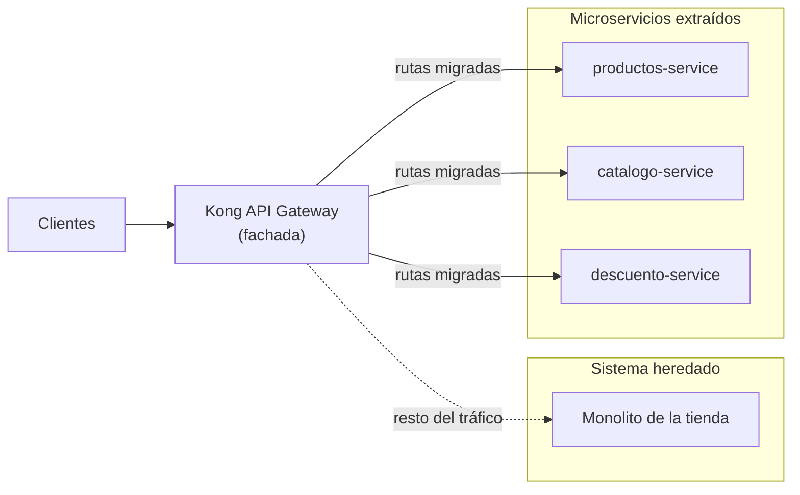

# Aplicativos del Bootcamp: migración de una tienda en línea con el patrón Strangler Fig


Monorepo del **Bootcamp EspecializATT** con los microservicios extraídos de una tienda en línea monolítica, junto con sus pruebas y la documentación técnica de la migración. El monolito se descompone de forma gradual aplicando el patrón **Strangler Fig**: cada capacidad se reimplementa como microservicio y el tráfico se redirige poco a poco, sin detener el sistema original.

> **Alcance:** código de ejemplo para formación. No está pensado para producción sin una revisión de seguridad y de calidad adicional.

## Tabla de contenidos

- [El patrón Strangler Fig](#el-patrón-strangler-fig)
- [Servicios](#servicios)
- [Pruebas](#pruebas)
- [Estructura del repositorio](#estructura-del-repositorio)
- [Requisitos previos](#requisitos-previos)
- [Inicio rápido](#inicio-rápido)
- [Documentación](#documentación)
- [Despliegue](#despliegue)
- [Seguridad](#seguridad)
- [Recursos](#recursos)

## El patrón Strangler Fig

El patrón coloca una **fachada** (en este laboratorio, Kong API Gateway) delante del sistema heredado. Las rutas ya migradas se dirigen a los microservicios nuevos y el resto del tráfico sigue llegando al monolito. Cuando una capacidad está migrada y validada, se retira del monolito.



Pasos de cada migración:

1. **Identificar** la capacidad a extraer del monolito.
2. **Implementar** el microservicio con sus propias pruebas.
3. **Redirigir** en la fachada las rutas de esa capacidad hacia el servicio nuevo.
4. **Validar** con pruebas funcionales y de rendimiento.
5. **Retirar** el código equivalente del monolito.


## Servicios

| Servicio | Directorio | Descripción |
|---|---|---|
| Productos | [`code/productos-service`](code/productos-service) | Gestión de productos <!-- TODO: endpoints y puerto --> |
| Catálogo | [`code/catalogo-service`](code/catalogo-service) | Consulta del catálogo <!-- TODO: endpoints y puerto --> |
| Descuento | [`code/descuento-service`](code/descuento-service) | Cálculo de descuentos <!-- TODO: endpoints y puerto --> |

Cada servicio es un proyecto Maven independiente que incluye su `pom.xml`, su `Dockerfile` y su configuración de Checkstyle (`checkstyle.xml`).


## Pruebas

| Proyecto | Directorio | Propósito |
|---|---|---|
| Pruebas funcionales | [`code/pruebas-funcionales`](code/pruebas-funcionales) | Validan el comportamiento de los servicios a través de su API |
| Pruebas de rendimiento | [`code/prueba-performance`](code/prueba-performance) | Miden el comportamiento bajo carga |
| PoC de prueba funcional | [`code/poc-prueba-funcional`](code/poc-prueba-funcional) | Prueba de concepto del enfoque de pruebas funcionales |
| PoC de IVA | [`code/poc-iva`](code/poc-iva) | Prueba de concepto relacionada con el cálculo del IVA |


## Estructura del repositorio

```text
.
├── code/
│   ├── productos-service/     # Microservicio de productos
│   ├── catalogo-service/      # Microservicio de catálogo
│   ├── descuento-service/     # Microservicio de descuentos
│   ├── pruebas-funcionales/   # Pruebas funcionales de la API
│   ├── prueba-performance/    # Pruebas de rendimiento
│   ├── poc-prueba-funcional/  # PoC de pruebas funcionales
│   └── poc-iva/               # PoC de cálculo de IVA
├── docs/
│   ├── adr/                   # Architecture Decision Records
│   ├── security/
│   │   └── threat-modeling/   # Modelado de amenazas
│   └── sdlc-and-tools.md      # Ciclo de vida de desarrollo y herramientas
└── README.md
```

Cada directorio dentro de `code/` es un proyecto Maven independiente: no existe un POM raíz, por lo que los comandos se ejecutan por módulo.

## Requisitos previos

| Herramienta | Versión | Notas |
|---|---|---|
| [Java JDK](https://adoptium.net/) | 21 | <!-- TODO: confirmar versión --> |
| [Apache Maven](https://maven.apache.org/download.cgi) | 3.9+ | Compilación y pruebas |
| [Docker](https://docs.docker.com/get-docker/) o Podman | última | Construcción de imágenes |

## Inicio rápido

**1. Clonar el repositorio**

```bash
git clone https://github.com/bootcamp-att/aplicativos.git
cd aplicativos
```

**2. Compilar y probar un servicio**

```bash
mvn -f code/productos-service/pom.xml clean verify
```

Repite el comando cambiando el directorio para `catalogo-service` y `descuento-service`.

**3. Construir la imagen del contenedor**

```bash
docker build -t productos-service code/productos-service
```

**4. Ejecutar el contenedor**

```bash
docker run --rm -p <puerto>:<puerto> productos-service
```

Sustituye `<puerto>` por el puerto en el que escucha el servicio.


## Documentación

| Documento | Contenido |
|---|---|
| [`docs/adr/`](docs/adr) | Decisiones de arquitectura y su justificación |
| [`docs/security/threat-modeling/`](docs/security/threat-modeling) | Modelado de amenazas de los servicios |
| [`docs/sdlc-and-tools.md`](docs/sdlc-and-tools.md) | Ciclo de vida de desarrollo seguro y herramientas utilizadas |

## Despliegue

Los servicios se despliegan en un clúster Kubernetes (k3s) creado con el repositorio de infraestructura:

- [`bootcamp-att/infraestructura`](https://github.com/bootcamp-att/infraestructura): Terraform y Ansible del laboratorio.


## Seguridad

- El modelado de amenazas está en [`docs/security/threat-modeling/`](docs/security/threat-modeling).
- No subas secretos, credenciales ni archivos `.env` al repositorio.
- Mantén las dependencias actualizadas y revisa los análisis de calidad antes de integrar cambios.

## Recursos

- [Strangler Fig Application (Martin Fowler)](https://martinfowler.com/bliki/StranglerFigApplication.html)
- [Patrón Strangler Fig (Azure Architecture Center)](https://learn.microsoft.com/en-us/azure/architecture/patterns/strangler-fig)
- [Maven: guía de inicio](https://maven.apache.org/guides/getting-started/)
- [Checkstyle](https://checkstyle.org/)
- [Buenas prácticas para Dockerfile](https://docs.docker.com/build/building/best-practices/)

