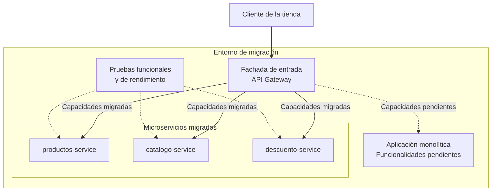

# Migración de una tienda en línea a microservicios

[](https://openjdk.org/)
[](https://maven.apache.org/)
[](https://spring.io/projects/spring-boot)
[](https://microservices.io/)
[](https://martinfowler.com/bliki/StranglerFigApplication.html)

Repositorio de código del Bootcamp EspecializATT para el ejercicio de
modernización de una tienda en línea mediante la migración progresiva
de un sistema monolítico hacia una arquitectura de microservicios.

El repositorio contiene los microservicios desarrollados durante la
migración, proyectos de pruebas y documentación técnica relacionada
con el ciclo de vida de desarrollo y la arquitectura de la solución.

## Tabla de contenidos

- [1. Contexto del proyecto](#1-contexto-del-proyecto)
- [2. Objetivos](#2-objetivos)
- [3. Alcance del repositorio](#3-alcance-del-repositorio)
- [4. Arquitectura de la solución](#4-arquitectura-de-la-solución)
- [5. Componentes de la aplicación](#5-componentes-de-la-aplicación)
- [6. Estrategia de pruebas](#6-estrategia-de-pruebas)
- [7. Tecnologías](#7-tecnologías)
- [8. Requisitos previos](#8-requisitos-previos)
- [9. Instalación y compilación](#9-instalación-y-compilación)
- [10. Ejecución de las pruebas](#10-ejecución-de-las-pruebas)
- [11. Estructura del repositorio](#11-estructura-del-repositorio)
- [12. Documentación técnica](#12-documentación-técnica)
- [13. Seguridad](#13-seguridad)
- [14. Referencias](#14-referencias)

## 1. Contexto del proyecto

El proyecto representa un escenario de modernización de una tienda
en línea cuyo sistema original está implementado como una aplicación
monolítica.

El objetivo del ejercicio es extraer progresivamente capacidades
del sistema existente y convertirlas en microservicios independientes,
con contratos de comunicación definidos y mecanismos de verificación
que permitan evaluar su comportamiento.

La migración utiliza el patrón arquitectónico **Strangler Fig**,
que permite introducir una nueva implementación de forma gradual
mientras el sistema heredado continúa atendiendo las funcionalidades
que todavía no han sido migradas.

Este enfoque permite reducir la necesidad de realizar una sustitución
completa del sistema en una única liberación.

## 2. Objetivos

Los objetivos del ejercicio son:

- Separar capacidades de negocio en servicios con responsabilidades
  específicas.
- Definir contratos para la comunicación entre servicios.
- Facilitar la compilación y verificación independiente de cada
  microservicio.
- Incorporar pruebas funcionales para comprobar el comportamiento
  de las APIs.
- Incorporar pruebas de rendimiento para evaluar el comportamiento
  de los servicios bajo carga.
- Documentar las decisiones de arquitectura y las consideraciones
  de seguridad.
- Proporcionar una base técnica para estudiar la migración progresiva
  desde una arquitectura monolítica hacia microservicios.

## 3. Alcance del repositorio

Este repositorio contiene los siguientes elementos:

- Código fuente de los microservicios de productos, catálogo
  y descuentos.
- Proyectos de pruebas funcionales y de rendimiento.
- Pruebas de concepto relacionadas con funcionalidades y estrategias
  de prueba.
- Archivos de construcción Maven y configuración de calidad del código.
- Dockerfiles para los microservicios que los incluyen.
- Documentación técnica, decisiones de arquitectura y modelado
  de amenazas.

### Fuera del alcance

Este repositorio no debe considerarse, por sí solo, la solución
completa de infraestructura y despliegue.

La configuración de infraestructura, aprovisionamiento y despliegue
se gestiona por separado.

Consulta el repositorio de infraestructura para conocer los recursos
externos necesarios para desplegar e integrar los servicios.

## 4. Arquitectura de la solución

### 4.1. Patrón Strangler Fig

El patrón Strangler Fig permite sustituir progresivamente partes
de una aplicación existente mediante la incorporación de nuevas
implementaciones.

En el escenario de este proyecto, una fachada de entrada puede
dirigir las solicitudes correspondientes a capacidades migradas
hacia los microservicios nuevos, mientras las funcionalidades
pendientes de migración continúan atendidas por el sistema heredado.

El proceso conceptual es el siguiente:

1. Identificar una capacidad de negocio dentro del monolito.
2. Implementar su nueva versión como microservicio.
3. Verificar su comportamiento mediante pruebas.
4. Redirigir el tráfico correspondiente hacia la nueva implementación.
5. Comprobar la integración y el comportamiento del sistema.
6. Retirar la implementación heredada cuando se hayan satisfecho
   los criterios de migración.

La retirada de una funcionalidad del monolito debe realizarse
después de verificar que la nueva implementación satisface
los requisitos establecidos.

### 4.2. Vista conceptual de la arquitectura

El siguiente diagrama representa el enfoque de migración.
No constituye un inventario de los recursos desplegados ni una
descripción exhaustiva de la configuración actual.



**Nota:** las rutas de integración, la disponibilidad del sistema
heredado y las relaciones entre los componentes deben verificarse
con la configuración de despliegue correspondiente.

### 4.3. Comunicación entre microservicios

Los contratos de API permiten establecer las operaciones disponibles,
los parámetros de entrada y los formatos de respuesta.

Las especificaciones OpenAPI constituyen una referencia para
documentar estos contratos y, cuando corresponda, generar interfaces
y clientes HTTP.

La implementación de `productos-service` incluye configuración
para generar interfaces de servidor y clientes a partir de
especificaciones OpenAPI.

Consulta los archivos de especificación y la configuración Maven
de cada servicio para conocer los contratos efectivamente definidos.

## 5. Componentes de la aplicación

Los proyectos se encuentran organizados en el directorio `code/`.

### 5.1. Microservicios

| Componente | Directorio | Responsabilidad |
|---|---|---|
| Productos | `code/productos-service/` | Capacidades relacionadas con productos. |
| Catálogo | `code/catalogo-service/` | Capacidades relacionadas con la consulta del catálogo. |
| Descuentos | `code/descuento-service/` | Capacidades relacionadas con los descuentos. |

Cada microservicio cuenta con su propio `pom.xml` y se compila
de forma independiente.

Los servicios que incluyen `Dockerfile` disponen de una definición
para construir su imagen de contenedor.

### 5.2. Proyectos de prueba y pruebas de concepto

| Proyecto | Directorio | Propósito |
|---|---|---|
| Pruebas funcionales | `code/pruebas-funcionales/` | Verificar el comportamiento de las APIs. |
| Pruebas de rendimiento | `code/prueba-performance/` | Evaluar el comportamiento de los servicios bajo carga. |
| PoC de pruebas funcionales | `code/poc-prueba-funcional/` | Explorar un enfoque de pruebas funcionales. |
| PoC de IVA | `code/poc-iva/` | Implementar una prueba de concepto relacionada con el IVA. |

Los proyectos de prueba son independientes de los microservicios
y pueden requerir una aplicación desplegada y accesible para ejecutarse.

## 6. Estrategia de pruebas

Las pruebas permiten verificar las funcionalidades implementadas
y evaluar aspectos específicos del comportamiento de los servicios.

### 6.1. Pruebas funcionales

El proyecto `pruebas-funcionales` utiliza REST Assured y JUnit 5,
e incorpora ExtentReports como dependencia para la generación
de informes.

Su propósito es comprobar el comportamiento observable de las APIs,
incluidas las respuestas y las condiciones definidas en los casos
de prueba.

La cobertura concreta depende de los escenarios implementados.

### 6.2. Pruebas de rendimiento

El proyecto `prueba-performance` utiliza Gatling.

Este tipo de pruebas permite estudiar el comportamiento de los
servicios bajo diferentes condiciones de carga.

Los escenarios, la concurrencia, la duración de las pruebas
y los criterios de aceptación deben consultarse en la implementación
correspondiente.

Los resultados deben interpretarse considerando las características
del entorno en el que se ejecutan.

### 6.3. Pruebas de concepto

Los proyectos `poc-prueba-funcional` y `poc-iva` permiten explorar
y validar enfoques específicos.

No deben interpretarse automáticamente como pruebas de aceptación
de la solución completa.

## 7. Tecnologías

El proyecto utiliza las siguientes tecnologías, según la configuración
de los módulos revisados:

- **Java:** lenguaje de programación.
- **Apache Maven:** gestión de dependencias y construcción.
- **Spring Boot:** framework utilizado por `productos-service`.
- **OpenAPI Generator:** generación de interfaces y clientes HTTP.
- **REST Assured:** pruebas de APIs REST.
- **JUnit 5:** ejecución de pruebas automatizadas.
- **ExtentReports:** dependencia para la elaboración de informes.
- **Gatling:** pruebas de rendimiento.
- **Docker:** construcción de imágenes de los servicios que incluyen
  un Dockerfile.
- **Checkstyle:** comprobación de convenciones de código en los
  módulos que lo configuran.
- **CycloneDX Maven Plugin:** generación de un inventario de
  componentes de software en los módulos que lo configuran.
- **JaCoCo:** recopilación y generación de informes de cobertura
  en los módulos que lo configuran.

La disponibilidad de cada herramienta y su configuración efectiva
dependen del módulo correspondiente.

## 8. Requisitos previos

Para compilar los proyectos revisados se recomienda disponer de:

- JDK 17.
- Apache Maven compatible con los proyectos.
- Git.
- Acceso a los repositorios Maven necesarios para descargar
  las dependencias.

Para construir y ejecutar contenedores también se requiere Docker
o una herramienta compatible, como Podman.

Para ejecutar las pruebas funcionales de integración se necesita
acceso al servicio que se desea evaluar.

Antes de ejecutar cualquier módulo, verifica su `pom.xml` y sus
archivos de configuración para confirmar los requisitos específicos.

## 9. Instalación y compilación

### 9.1. Clonar el repositorio

```bash
git clone https://github.com/bootcamp-att/aplicativos.git

cd aplicativos
```

### 9.2. Verificar las herramientas

```bash
java -version

mvn -version
```

Comprueba que Maven utiliza la versión del JDK esperada.

### 9.3. Compilar un microservicio

Por ejemplo, para compilar `productos-service`:

```bash
mvn -f code/productos-service/pom.xml clean verify
```

Para compilar los otros microservicios:

```bash
mvn -f code/catalogo-service/pom.xml clean verify

mvn -f code/descuento-service/pom.xml clean verify
```

Estos comandos ejecutan el ciclo de construcción y verificación
de Maven configurado para cada módulo.

El resultado dependerá de que las dependencias estén disponibles
y de que el código y las pruebas finalicen correctamente.

### 9.4. Construir una imagen de contenedor

Para construir la imagen de `productos-service`:

```bash
docker build \
  -t productos-service:local \
  code/productos-service
```

Este comando construye la imagen utilizando el Dockerfile del
microservicio.

Para ejecutar el contenedor, consulta la configuración del servicio
y determina el puerto de escucha y las variables de entorno necesarias.

No se especifica un mapeo de puertos genérico porque debe corresponder
a la configuración efectiva de la aplicación.

## 10. Ejecución de las pruebas

### 10.1. Pruebas funcionales

El proyecto se encuentra en:

`code/pruebas-funcionales/`

Para ejecutar las pruebas utilizando la URL configurada en el proyecto:

```bash
mvn -f code/pruebas-funcionales/pom.xml test
```

Para especificar otro destino:

```bash
mvn -f code/pruebas-funcionales/pom.xml test \
  -Dbase.url=https://host-de-pruebas.example
```

Sustituye el destino de ejemplo por la URL del entorno autorizado
que deseas evaluar.

Antes de ejecutar las pruebas, comprueba que el servicio esté
disponible y que la configuración de TLS y las credenciales,
si fueran necesarias, sean correctas.

Los informes disponibles dependen de la implementación de las
pruebas y de la configuración de Maven.

### 10.2. Pruebas de rendimiento

El proyecto se encuentra en:

`code/prueba-performance/`

Para ejecutar las simulaciones configuradas:

```bash
mvn -f code/prueba-performance/pom.xml gatling:test
```

Consulta las simulaciones implementadas antes de ejecutar una prueba
de carga.

Las pruebas de rendimiento deben dirigirse únicamente a entornos
autorizados y dimensionados para recibir la carga prevista.

### 10.3. Pruebas de concepto

Los proyectos de prueba de concepto se compilan y ejecutan
independientemente.

Para consultar su configuración:

```bash
cat code/poc-iva/pom.xml

cat code/poc-prueba-funcional/pom.xml
```

Los objetivos Maven disponibles y los requisitos de ejecución
deben verificarse en cada proyecto.

## 11. Estructura del repositorio

```text
.
├── code/
│   ├── catalogo-service/
│   │   ├── pom.xml
│   │   ├── Dockerfile
│   │   └── src/
│   ├── descuento-service/
│   │   ├── pom.xml
│   │   ├── Dockerfile
│   │   └── src/
│   ├── productos-service/
│   │   ├── pom.xml
│   │   ├── Dockerfile
│   │   └── src/
│   ├── pruebas-funcionales/
│   │   ├── pom.xml
│   │   └── src/
│   ├── prueba-performance/
│   │   ├── pom.xml
│   │   └── src/
│   ├── poc-prueba-funcional/
│   │   ├── pom.xml
│   │   └── src/
│   └── poc-iva/
│       ├── pom.xml
│       └── src/
├── docs/
│   ├── adr/
│   ├── security/
│   │   └── threat-modeling/
│   └── sdlc-and-tools.md
└── README.md
```

Cada módulo Maven mantiene su propia configuración de construcción.
No se presupone un proyecto Maven raíz que agregue todos los módulos.

## 12. Documentación técnica

La documentación complementaria se encuentra en `docs/`.

### Decisiones de arquitectura

Directorio:

[`docs/adr/`](docs/adr/)

Contiene el espacio destinado a documentar las decisiones de
arquitectura y sus justificaciones.

### Modelado de amenazas

Directorio:

[`docs/security/threat-modeling/`](docs/security/threat-modeling/)

Espacio destinado a la documentación de amenazas y consideraciones
de seguridad de los componentes.

### Ciclo de vida de desarrollo y herramientas

Documento:

[`docs/sdlc-and-tools.md`](docs/sdlc-and-tools.md)

Describe la metodología de trabajo y las tecnologías utilizadas
en el proyecto.

### Infraestructura

La infraestructura se administra en un repositorio independiente:

[bootcamp-att/infraestructura](https://github.com/bootcamp-att/infraestructura)

Consulta ese repositorio para conocer el aprovisionamiento y la
configuración del entorno de despliegue.

## 13. Seguridad

Este repositorio forma parte de un ejercicio de formación y
modernización de aplicaciones.

Antes de utilizar sus componentes en un entorno productivo,
es necesario realizar una evaluación específica de seguridad,
calidad, disponibilidad y operación.

Se recomienda:

- No almacenar credenciales, tokens ni claves privadas en el código.
- No incorporar secretos en archivos versionados.
- Revisar y actualizar las dependencias.
- Analizar las imágenes de contenedor y sus componentes.
- Validar los contratos y los mecanismos de autenticación
  y autorización de las APIs.
- Revisar el modelado de amenazas.
- Ejecutar pruebas de seguridad y calidad en el proceso de integración.
- Documentar las limitaciones y los riesgos conocidos.

La existencia de herramientas de análisis o archivos de configuración
no implica, por sí sola, que una aplicación sea segura o cumpla
un estándar de seguridad.

## 14. Referencias

- Fowler, M. (2004). *Strangler Fig Application*.
  https://martinfowler.com/bliki/StranglerFigApplication.html

- Microsoft. *Strangler Fig pattern*.
  https://learn.microsoft.com/en-us/azure/architecture/patterns/strangler-fig

- Apache Maven. *Maven Getting Started Guide*.
  https://maven.apache.org/guides/getting-started/

- OpenAPI Initiative. *OpenAPI Specification*.
  https://spec.openapis.org/oas/latest.html

- REST Assured.
  https://rest-assured.io/

- Gatling. *Documentation*.
  https://docs.gatling.io/

- CycloneDX. *Official documentation*.
  https://cyclonedx.org/

---

**Bootcamp EspecializATT**

Repositorio de aplicaciones y pruebas para el ejercicio de migración
progresiva de una tienda en línea.