# Migración de una tienda en línea a microservicios

Repositorio de aplicaciones y pruebas del ejercicio de modernización de una tienda en línea del Bootcamp EspecializATT.

El proyecto aborda la separación de capacidades de negocio en microservicios, la definición de contratos de comunicación, la integración de servicios y la verificación de su comportamiento mediante pruebas automatizadas.

La solución toma como referencia el patrón arquitectónico **Strangler Fig** para contextualizar la migración progresiva de sistemas monolíticos hacia arquitecturas de microservicios.

> **Alcance del proyecto:** este repositorio contiene los microservicios desarrollados durante el ejercicio, los proyectos de pruebas y la documentación técnica asociada. El sistema monolítico original no forma parte de la implementación desarrollada en el bootcamp.

## Tabla de contenidos

- [1. Contexto](#1-contexto)
- [2. Objetivos](#2-objetivos)
- [3. Alcance](#3-alcance)
- [4. Arquitectura](#4-arquitectura)
- [5. Flujo de una solicitud](#5-flujo-de-una-solicitud)
- [6. Microservicios](#6-microservicios)
- [7. Persistencia de datos](#7-persistencia-de-datos)
- [8. Pruebas](#8-pruebas)
- [9. Tecnologías](#9-tecnologías)
- [10. Requisitos previos](#10-requisitos-previos)
- [11. Instalación y compilación](#11-instalación-y-compilación)
- [12. Ejecución de las pruebas](#12-ejecución-de-las-pruebas)
- [13. Estructura del repositorio](#13-estructura-del-repositorio)
- [14. Documentación técnica](#14-documentación-técnica)
- [15. Consideraciones de seguridad](#15-consideraciones-de-seguridad)
- [16. Referencias](#16-referencias)

## 1. Contexto

Las aplicaciones monolíticas agrupan múltiples capacidades de negocio dentro de una misma unidad de despliegue. A medida que evolucionan, determinadas necesidades de escalabilidad, mantenimiento, autonomía de desarrollo e integración pueden motivar la separación de dichas capacidades en servicios independientes.

Este proyecto utiliza el escenario de una tienda en línea para estudiar la organización de una aplicación basada en microservicios.

La solución separa las responsabilidades relacionadas con productos, catálogo y descuentos. Los servicios se comunican mediante interfaces HTTP y colaboran para construir la respuesta que recibe el consumidor de la API.

La arquitectura utiliza Kong API Gateway como punto de entrada y Kubernetes para el enrutamiento hacia los servicios desplegados en el clúster.

El patrón **Strangler Fig** se utiliza como referencia conceptual para contextualizar una posible estrategia de migración progresiva desde una aplicación monolítica hacia servicios independientes.

El ejercicio se concentra en el desarrollo, integración y pruebas de los microservicios. No incluye la implementación del monolito original ni una migración funcional entre ambos sistemas.

## 2. Objetivos

Los objetivos del proyecto son:

- Separar responsabilidades de negocio en microservicios.
- Definir contratos de comunicación entre servicios.
- Centralizar el acceso externo a la API mediante un API Gateway.
- Utilizar Kubernetes Ingress para encaminar solicitudes hacia los servicios.
- Separar la persistencia de los datos de catálogo y descuentos.
- Integrar información procedente de distintos servicios para construir una respuesta de negocio.
- Implementar pruebas funcionales para verificar el comportamiento de las APIs.
- Incorporar pruebas de rendimiento para evaluar el comportamiento de los servicios bajo carga.
- Documentar las decisiones arquitectónicas, las herramientas y las consideraciones de seguridad.
- Proporcionar una base para estudiar los desafíos de modernización y migración de aplicaciones.

## 3. Alcance

El repositorio contiene los siguientes componentes:

- Microservicio de productos.
- Microservicio de catálogo.
- Microservicio de descuentos.
- Proyectos de pruebas funcionales.
- Proyecto de pruebas de rendimiento.
- Pruebas de concepto.
- Configuración de construcción y dependencias Maven.
- Dockerfiles para los servicios que los incluyen.
- Configuración de herramientas de calidad de código en los módulos correspondientes.
- Documentación técnica relacionada con el ciclo de vida de desarrollo, las decisiones de arquitectura y el modelado de amenazas.

### Fuera del alcance

El repositorio no contiene la implementación del sistema monolítico original ni demuestra una migración funcional entre un monolito y los nuevos servicios.

Tampoco debe considerarse, por sí solo, el repositorio completo de infraestructura y despliegue.

La infraestructura se gestiona de forma independiente. Los detalles de aprovisionamiento, configuración y despliegue deben consultarse en el repositorio correspondiente.

## 4. Arquitectura

### 4.1. Vista general

La arquitectura está organizada alrededor de tres microservicios:

- `productos-service`
- `catalogo-service`
- `descuento-service`

Las solicitudes externas ingresan por Kong API Gateway y se encaminan mediante Kubernetes Ingress hacia `productos-service`.

Este servicio coordina las consultas a catálogo y descuentos, integra la información recibida y construye la respuesta de la API.

Los servicios de catálogo y descuentos administran sus propios datos mediante bases de datos PostgreSQL independientes.

### 4.2. Diagrama de arquitectura

```mermaid
flowchart TB
    CLIENTE["Cliente de la tienda<br/>Aplicación consumidora"]

    subgraph ENTRADA["Punto de entrada"]
        KONG["Kong API Gateway"]
    end

    subgraph K8S["Clúster de Kubernetes"]
        INGRESS["Kubernetes Ingress"]

        subgraph APLICACIONES["Capa de aplicación"]
            PRODUCTOS["productos-service<br/>Orquestación de consultas"]
            CATALOGO["catalogo-service"]
            DESCUENTOS["descuento-service"]
        end

        subgraph PERSISTENCIA["Capa de persistencia"]
            DB_CATALOGO[("PostgreSQL<br/>Datos de catálogo")]
            DB_DESCUENTOS[("PostgreSQL<br/>Datos de descuentos")]
        end

        INGRESS --> PRODUCTOS

        PRODUCTOS -->|"Consulta de catálogo"| CATALOGO
        PRODUCTOS -->|"Consulta de descuentos"| DESCUENTOS

        CATALOGO --> DB_CATALOGO
        DESCUENTOS --> DB_DESCUENTOS
    end

    CLIENTE -->|"Solicitud HTTP/HTTPS"| KONG
    KONG -->|"Enrutamiento"| INGRESS

    CATALOGO -->|"Respuesta de catálogo"| PRODUCTOS
    DESCUENTOS -->|"Respuesta de descuentos"| PRODUCTOS

    PRODUCTOS -->|"Respuesta agregada"| INGRESS
    INGRESS --> KONG
    KONG --> CLIENTE
```



**Nota:** el diagrama representa la arquitectura lógica descrita para el ejercicio. La ruta de retorno, los protocolos concretos y las reglas efectivas de enrutamiento deben contrastarse con la configuración de despliegue.

### 4.3. Responsabilidades de los componentes

**Kong API Gateway**

Constituye el punto de entrada para las solicitudes externas dirigidas a la API. Permite centralizar las políticas y el enrutamiento configurados en la puerta de enlace.

**Kubernetes Ingress**

Define las reglas de entrada y enrutamiento HTTP(S) hacia los servicios publicados dentro del clúster.

El comportamiento efectivo depende del controlador Ingress instalado y de las reglas configuradas.

**productos-service**

Implementa el punto de entrada de negocio para las consultas de productos. Coordina las solicitudes a los servicios internos y consolida los datos necesarios para responder al consumidor.

**catalogo-service**

Proporciona las operaciones relacionadas con la consulta y gestión de la información del catálogo, de acuerdo con su implementación.

**descuento-service**

Proporciona las operaciones relacionadas con la información de descuentos, de acuerdo con su implementación.

**Bases de datos PostgreSQL**

Almacenan los datos correspondientes a catálogo y descuentos. Cada servicio es responsable de acceder a su propia base de datos.

## 5. Flujo de una solicitud

Para ilustrar la interacción entre los componentes, consideremos una solicitud de consulta de producto.

Ejemplo conceptual:

```http
GET /api/v1/products/{id}
```

La operación y la ruta definitivas deben consultarse en el contrato OpenAPI del servicio.

El flujo es el siguiente:

1. **Solicitud del cliente.** La aplicación consumidora solicita los detalles de un producto.
2. **Entrada por Kong.** Kong recibe la solicitud y aplica las reglas configuradas.
3. **Enrutamiento en Kubernetes.** La solicitud llega al Ingress, que la dirige a `productos-service`.
4. **Consulta del catálogo.** `productos-service` solicita la información necesaria a `catalogo-service`.
5. **Consulta de descuentos.** `productos-service` solicita la información necesaria a `descuento-service`.
6. **Acceso a los datos.** Los servicios internos consultan sus respectivas bases de datos PostgreSQL.
7. **Respuesta de los servicios internos.** Catálogo y descuentos devuelven los datos solicitados a `productos-service`.
8. **Integración de la respuesta.** `productos-service` combina la información conforme a la lógica de negocio implementada.
9. **Respuesta al cliente.** La respuesta se devuelve a través de la ruta de entrada.

Desde la perspectiva del consumidor, la consulta se realiza contra una única API de productos, aunque internamente implique la interacción con varios servicios.

### 5.1. Contratos de comunicación

Los contratos de API definen las operaciones disponibles, los parámetros, los esquemas de datos y las respuestas esperadas.

OpenAPI permite describir estas interfaces de manera independiente de su implementación.

La configuración Maven de `productos-service` contempla la generación de interfaces de servidor y clientes HTTP a partir de especificaciones OpenAPI.

Los contratos definitivos deben consultarse en los archivos de especificación de cada servicio.

### 5.2. Dependencias entre servicios

`productos-service` depende de las respuestas de catálogo y descuentos para construir la respuesta agregada.

Esta relación introduce consideraciones de disponibilidad, latencia y manejo de errores.

Entre los aspectos relevantes para la evolución del proyecto se encuentran:

- Definir tiempos máximos de espera para las llamadas internas.
- Establecer políticas de manejo de errores.
- Evaluar la conveniencia de reintentos y circuit breakers.
- Determinar el comportamiento cuando un servicio interno no está disponible.
- Medir la latencia total de la operación.
- Evitar dependencias innecesarias entre contratos.

La existencia de estas consideraciones no implica que todas las medidas estén implementadas actualmente.

## 6. Microservicios

Los microservicios se encuentran en el directorio `code/`.

### 6.1. productos-service

**Directorio:** `code/productos-service/`

Servicio responsable de exponer la API de productos y coordinar las consultas necesarias para obtener la información de catálogo y descuentos.

Características relevantes:

- Proyecto Maven independiente.
- Código fuente Java.
- Configuración de generación de interfaces y clientes a partir de OpenAPI.
- Dockerfile para la construcción de una imagen de contenedor.
- Configuración de herramientas de calidad de código.

Para conocer las operaciones disponibles, consulta las especificaciones OpenAPI y la implementación del servicio.

### 6.2. catalogo-service

**Directorio:** `code/catalogo-service/`

Microservicio responsable de las operaciones relacionadas con el catálogo de productos.

Características relevantes:

- Proyecto Maven independiente.
- Código fuente Java.
- Dockerfile para la construcción de una imagen de contenedor.
- Configuración de Checkstyle.
- Persistencia mediante PostgreSQL en la arquitectura del ejercicio.

Las operaciones y los modelos de datos concretos deben consultarse en el código fuente y los contratos del servicio.

### 6.3. descuento-service

**Directorio:** `code/descuento-service/`

Microservicio responsable de las operaciones relacionadas con los descuentos.

Características relevantes:

- Proyecto Maven independiente.
- Código fuente Java.
- Dockerfile para la construcción de una imagen de contenedor.
- Configuración de Checkstyle.
- Persistencia mediante PostgreSQL en la arquitectura del ejercicio.

Las reglas de negocio y los contratos concretos deben consultarse en el código fuente del servicio.

## 7. Persistencia de datos

La arquitectura utiliza PostgreSQL para la persistencia de los datos de catálogo y descuentos.

Cada servicio administra sus propios datos:

- `catalogo-service` accede a la base de datos del catálogo.
- `descuento-service` accede a la base de datos de descuentos.

`productos-service` consume las interfaces de los servicios internos para obtener información. No necesita consultar directamente sus bases de datos.

Este enfoque permite separar las responsabilidades de negocio y reducir el acoplamiento entre los servicios y sus modelos de persistencia.

La separación lógica de responsabilidades no determina, por sí sola, si las bases de datos se ejecutan en servidores distintos o comparten una misma instancia de PostgreSQL. Ese detalle depende de la configuración de infraestructura.

## 8. Pruebas

El repositorio incluye proyectos para verificar el comportamiento de las APIs y evaluar aspectos del rendimiento.

### 8.1. Pruebas funcionales

**Directorio:** `code/pruebas-funcionales/`

El proyecto utiliza REST Assured y JUnit 5, e incorpora ExtentReports como dependencia para la elaboración de informes.

Su propósito es validar el comportamiento observable de las APIs mediante solicitudes HTTP y aserciones sobre las respuestas.

La cobertura efectiva depende de los escenarios implementados en el código de pruebas.

### 8.2. Pruebas de rendimiento

**Directorio:** `code/prueba-performance/`

El proyecto utiliza Gatling para ejecutar escenarios de rendimiento.

Estas pruebas permiten evaluar el comportamiento de los servicios bajo diferentes condiciones de carga.

Entre las métricas que pueden resultar relevantes se encuentran:

- Tiempo de respuesta.
- Latencia percentil.
- Tasa de solicitudes procesadas.
- Porcentaje de errores.
- Comportamiento bajo concurrencia.

Las métricas obtenidas y los criterios de aceptación deben documentarse a partir de las simulaciones y los resultados reales.

### 8.3. Pruebas de concepto

El repositorio contiene dos proyectos adicionales:

**`code/poc-prueba-funcional/`**

Proyecto de prueba de concepto relacionado con las pruebas funcionales.

**`code/poc-iva/`**

Proyecto de prueba de concepto relacionado con el IVA.

Estos módulos se mantienen separados de los microservicios principales para facilitar la experimentación sin mezclar sus objetivos con los de la aplicación.

### 8.4. Alcance de las pruebas

La existencia de un proyecto de pruebas no implica que todas las funcionalidades estén cubiertas ni que se hayan alcanzado determinados objetivos de calidad.

La cobertura, los escenarios, las condiciones de ejecución y los resultados deben verificarse mediante el código y los informes generados.

## 9. Tecnologías

Las tecnologías utilizadas o configuradas en los proyectos incluyen:

| Tecnología | Propósito |
|---|---|
| Java | Desarrollo de los servicios y proyectos de pruebas. |
| Apache Maven | Gestión de dependencias y construcción de los proyectos. |
| Spring Boot | Framework utilizado por `productos-service`. |
| OpenAPI | Descripción de los contratos de API. |
| OpenAPI Generator | Generación de interfaces y clientes HTTP. |
| REST Assured | Pruebas de APIs REST. |
| JUnit 5 | Ejecución de pruebas automatizadas. |
| ExtentReports | Elaboración de informes de pruebas. |
| Gatling | Pruebas de rendimiento. |
| Docker | Construcción de imágenes de contenedor. |
| Checkstyle | Verificación de convenciones de código. |
| PostgreSQL | Persistencia de datos de catálogo y descuentos. |
| Kong API Gateway | Punto de entrada y enrutamiento de solicitudes. |
| Kubernetes | Orquestación de contenedores. |
| Kubernetes Ingress | Enrutamiento de tráfico hacia los servicios del clúster. |

La configuración y disponibilidad de cada tecnología dependen del módulo y del entorno de despliegue.

## 10. Requisitos previos

Para compilar los proyectos Java se recomienda disponer de:

- JDK 17.
- Apache Maven compatible con los proyectos.
- Git.
- Acceso a los repositorios Maven necesarios para descargar las dependencias.

Para construir imágenes se requiere Docker o una herramienta compatible, como Podman.

Para ejecutar las pruebas funcionales de integración se necesita acceso al entorno en el que estén desplegados los servicios.

Para ejecutar pruebas de rendimiento se necesita un entorno autorizado y con capacidad suficiente para soportar la carga prevista.

Verifica los archivos `pom.xml` de cada módulo para confirmar sus requisitos específicos.

## 11. Instalación y compilación

### 11.1. Clonar el repositorio

```bash
git clone https://github.com/bootcamp-att/aplicativos.git

cd aplicativos
```

### 11.2. Verificar Java y Maven

```bash
java -version

mvn -version
```

Comprueba que Maven utiliza el JDK esperado por los proyectos.

### 11.3. Compilar los microservicios

Cada microservicio tiene su propio proyecto Maven.

Para compilar `productos-service`:

```bash
mvn -f code/productos-service/pom.xml clean verify
```

Para compilar `catalogo-service`:

```bash
mvn -f code/catalogo-service/pom.xml clean verify
```

Para compilar `descuento-service`:

```bash
mvn -f code/descuento-service/pom.xml clean verify
```

El objetivo `verify` ejecuta las fases anteriores del ciclo de vida Maven y las comprobaciones configuradas para cada módulo.

El resultado depende de la disponibilidad de las dependencias, la configuración del proyecto y el resultado de las pruebas.

### 11.4. Compilar los proyectos de pruebas

Pruebas funcionales:

```bash
mvn -f code/pruebas-funcionales/pom.xml clean verify
```

Pruebas de rendimiento:

```bash
mvn -f code/prueba-performance/pom.xml clean verify
```

Prueba de concepto funcional:

```bash
mvn -f code/poc-prueba-funcional/pom.xml clean verify
```

Prueba de concepto de IVA:

```bash
mvn -f code/poc-iva/pom.xml clean verify
```

Estos comandos permiten verificar los módulos individualmente. No sustituyen la ejecución de pruebas de integración contra un entorno desplegado.

### 11.5. Construir una imagen de contenedor

Los microservicios que incluyen un Dockerfile pueden construirse individualmente.

Ejemplo para `productos-service`:

```bash
docker build \
  -t productos-service:local \
  code/productos-service
```

Ejemplo para `catalogo-service`:

```bash
docker build \
  -t catalogo-service:local \
  code/catalogo-service
```

Ejemplo para `descuento-service`:

```bash
docker build \
  -t descuento-service:local \
  code/descuento-service
```

Estos comandos construyen las imágenes. La ejecución requiere configurar los puertos, las variables de entorno, las dependencias y la conectividad necesarias para cada servicio.

La construcción de una imagen no implica que el servicio esté desplegado o integrado con Kubernetes.

## 12. Ejecución de las pruebas

### 12.1. Pruebas funcionales

Para ejecutar el proyecto de pruebas funcionales:

```bash
mvn -f code/pruebas-funcionales/pom.xml test
```

El proyecto debe configurarse para apuntar al entorno que se desea evaluar.

Si el parámetro `base.url` está disponible en la configuración de Maven, puede especificarse de la siguiente manera:

```bash
mvn -f code/pruebas-funcionales/pom.xml test \
  -Dbase.url=https://host-de-pruebas.example
```

Sustituye el destino de ejemplo por la URL real del entorno autorizado.

Antes de ejecutar las pruebas, verifica:

- Que Kong y los servicios necesarios estén disponibles.
- Que la ruta de la API corresponda a la configuración del entorno.
- Que las credenciales y los mecanismos de autenticación requeridos estén configurados.
- Que la configuración TLS sea compatible con el certificado del entorno.

Los informes disponibles dependen de la configuración y de los mecanismos de generación implementados en el proyecto.

### 12.2. Pruebas de rendimiento

Para ejecutar las simulaciones configuradas en Gatling:

```bash
mvn -f code/prueba-performance/pom.xml gatling:test
```

Consulta el código de las simulaciones para identificar el destino, la duración, los perfiles de carga y las condiciones de ejecución.

Las pruebas deben dirigirse únicamente a entornos autorizados.

Los resultados deben interpretarse considerando los recursos del entorno, la configuración de los servicios y las características de la carga aplicada.

## 13. Estructura del repositorio

La organización del repositorio es la siguiente:

```text
.
├── code/
│   ├── catalogo-service/
│   │   ├── checkstyle.xml
│   │   ├── Dockerfile
│   │   ├── pom.xml
│   │   └── src/
│   │
│   ├── descuento-service/
│   │   ├── checkstyle.xml
│   │   ├── Dockerfile
│   │   ├── pom.xml
│   │   └── src/
│   │
│   ├── poc-iva/
│   │   ├── pom.xml
│   │   └── src/
│   │
│   ├── poc-prueba-funcional/
│   │   ├── pom.xml
│   │   └── src/
│   │
│   ├── productos-service/
│   │   ├── checkstyle.xml
│   │   ├── Dockerfile
│   │   ├── pom.xml
│   │   └── src/
│   │
│   ├── prueba-performance/
│   │   ├── pom.xml
│   │   └── src/
│   │
│   └── pruebas-funcionales/
│       ├── pom.xml
│       └── src/
│
├── docs/
│   ├── adr/
│   ├── sdlc-and-tools.md
│   └── security/
│       └── threat-modeling/
│
└── README.md
```

### Organización

**`code/`**

Contiene los microservicios, las pruebas funcionales, las pruebas de rendimiento y las pruebas de concepto.

**`docs/`**

Contiene la documentación técnica relacionada con las decisiones de arquitectura, el ciclo de vida de desarrollo y el modelado de amenazas.

**`README.md`**

Proporciona el punto de entrada al repositorio y explica su propósito, arquitectura, tecnologías y procedimientos generales de compilación y pruebas.

Cada módulo Maven dispone de su propia configuración. No se presupone un proyecto Maven raíz que coordine la construcción de todos los módulos.

## 14. Documentación técnica

### 14.1. Ciclo de vida de desarrollo y herramientas

Documento:

[`docs/sdlc-and-tools.md`](docs/sdlc-and-tools.md)

Consulta este archivo para conocer la documentación relacionada con el ciclo de vida de desarrollo y las herramientas del proyecto.

### 14.2. Decisiones de arquitectura

Directorio:

[`docs/adr/`](docs/adr/)

Este directorio está destinado a registrar las decisiones de arquitectura y sus justificaciones.

Una decisión de arquitectura debería describir el contexto, la decisión tomada, las alternativas consideradas y sus consecuencias.

### 14.3. Modelado de amenazas

Directorio:

[`docs/security/threat-modeling/`](docs/security/threat-modeling/)

Este directorio está destinado a documentar amenazas, superficies de ataque y consideraciones de seguridad de la solución.

### 14.4. Infraestructura

La infraestructura se administra en un repositorio independiente:

[bootcamp-att/infraestructura](https://github.com/bootcamp-att/infraestructura)

Consulta ese repositorio para revisar la configuración de infraestructura y los recursos de despliegue.

## 15. Consideraciones de seguridad

La solución forma parte de un ejercicio de desarrollo y modernización de aplicaciones.

Antes de utilizar sus componentes en un entorno productivo, es necesario realizar una evaluación de seguridad, disponibilidad, calidad y operación.

Se recomienda:

- No almacenar credenciales, tokens ni claves privadas en el repositorio.
- Mantener los secretos fuera de los archivos versionados.
- Revisar y actualizar las dependencias.
- Analizar las imágenes de contenedor y sus componentes.
- Validar los contratos y las reglas de acceso de las APIs.
- Aplicar autenticación y autorización según los requisitos de cada operación.
- Limitar la exposición de los servicios internos.
- Documentar las amenazas identificadas y las medidas de mitigación.
- Incorporar pruebas de seguridad al proceso de desarrollo.
- Revisar los tiempos de espera, el manejo de errores y la resiliencia de las llamadas entre servicios.

La presencia de herramientas de análisis o archivos de configuración no implica, por sí sola, que la solución cumpla un estándar de seguridad o esté preparada para producción.

## 16. Referencias

### Patrones arquitectónicos

Fowler, M. (2004). *Strangler Fig Application*.

https://martinfowler.com/bliki/StranglerFigApplication.html

Microsoft. (s. f.). *Strangler Fig pattern*.

https://learn.microsoft.com/en-us/azure/architecture/patterns/strangler-fig

### Microservicios

Microsoft. (s. f.). *Microservices architecture style*.

https://learn.microsoft.com/en-us/azure/architecture/guide/architecture-styles/microservices

### Contratos de API

OpenAPI Initiative. (s. f.). *OpenAPI Specification*.

https://spec.openapis.org/oas/latest.html

### Herramientas de desarrollo y pruebas

Apache Maven. (s. f.). *Maven documentation*.

https://maven.apache.org/guides/

REST Assured. (s. f.). *REST Assured documentation*.

https://rest-assured.io/

Gatling. (s. f.). *Gatling documentation*.

https://docs.gatling.io/

### Contenedores y orquestación

Docker. (s. f.). *Docker documentation*.

https://docs.docker.com/

Kubernetes. (s. f.). *Kubernetes documentation*.

https://kubernetes.io/docs/

Kong. (s. f.). *Kong Gateway documentation*.

https://docs.konghq.com/gateway/latest/

---

**Bootcamp EspecializATT**

Repositorio de aplicaciones y pruebas para el ejercicio de modernización de una tienda en línea.